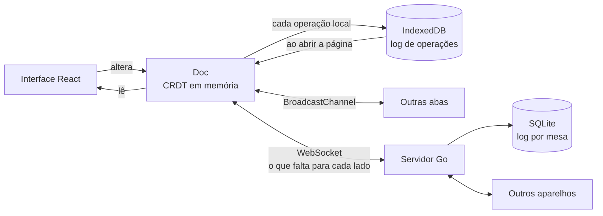

# mesa

**Motor de sincronização local-first, com CRDTs escritos do zero, e um quadro colaborativo que funciona offline.**

No mesa, toda alteração é gravada primeiro no aparelho de quem a fez. A rede é opcional: quando
existe, as réplicas trocam as operações que ainda não viram e convergem para o mesmo estado, sem
tela de conflito e sem "vence quem salvou por último" apagando o trabalho de alguém.

O projeto tem três partes:

- **`ui/core`**: a biblioteca de CRDTs em TypeScript, sem nenhuma dependência. Texto colaborativo
  (RGA), registros com último-escritor-vence, indexação fracionária, relógio de Lamport e vetores
  de versão.
- **`cmd/mesa` + `internal/`**: o servidor de sincronização em Go. WebSocket, log de operações
  durável em SQLite, presença.
- **`ui/src`**: o app. Um quadro kanban com texto colaborativo, modo avião, sincronização entre
  abas e um laboratório para provocar conflitos de propósito.

## Sumário

- [O que dá para ver funcionando](#o-que-dá-para-ver-funcionando)
- [Como rodar](#como-rodar)
- [Como funciona](#como-funciona)
- [Os CRDTs](#os-crdts)
- [O protocolo de sincronização](#o-protocolo-de-sincronização)
- [Testes](#testes)
- [Usar a biblioteca](#usar-a-biblioteca)
- [Estrutura do projeto](#estrutura-do-projeto)
- [Decisões e limites](#decisões-e-limites)

## O que dá para ver funcionando

| Situação | O que acontece |
|---|---|
| Você fecha o servidor e continua usando | Tudo funciona. As alterações ficam no IndexedDB e sobem quando o servidor volta |
| Duas pessoas editam a mesma descrição ao mesmo tempo | As duas edições ficam. Trechos digitados no mesmo ponto ficam inteiros, um depois do outro, na mesma ordem para todos |
| Duas pessoas arrastam o mesmo cartão para colunas diferentes | O cartão termina em exatamente um lugar, o mesmo para todos |
| Alguém apaga uma coluna enquanto outra pessoa, offline, põe um cartão nela | A coluna volta, com um aviso, em vez de o cartão sumir |
| Duas abas do mesmo navegador, sem rede nenhuma | Sincronizam entre si por `BroadcastChannel` |
| Você recarrega a página offline | O quadro abre do log local, sem esperar ninguém |
| A conexão cai antes de o servidor confirmar | As operações são reenviadas ao reconectar e gravadas uma vez só |
| Outra pessoa abre o mesmo cartão | Você vê o cursor e a seleção dela dentro do texto, e eles ficam no lugar certo enquanto você digita antes deles |
| Você clica em **Histórico** | Um controle deslizante volta o quadro a qualquer momento, dizendo quem fez o quê |
| O banco do servidor é apagado | Na próxima conexão, qualquer aparelho que tenha a mesa a reenvia inteira |

## Como rodar

Pré-requisitos: **Go 1.26+** e **Node 22+**. Sem Docker, sem banco para instalar: o SQLite é
embutido no binário (driver em Go puro, sem cgo).

```powershell
.\run.ps1
```

ou dois cliques em `run.bat`. O script instala as dependências, compila a interface, embute-a no
binário e abre `http://127.0.0.1:7979`.

| Comando | O que faz |
|---|---|
| `.\run.ps1` | Compila tudo e roda (um binário só) |
| `.\run.ps1 -Dev` | Servidor + Vite com hot reload em `http://localhost:5175` |
| `.\run.ps1 -Test` | Testes do servidor (Go), do núcleo CRDT e da sessão (vitest) e checagem de tipos |
| `.\run.ps1 -Port 8080 -NoBrowser` | Outra porta, sem abrir o navegador |

Os logs de operações ficam em `data/mesa.db`.

### Roteiro de 3 minutos

1. **Laboratório.** Clique em *Laboratório de conflitos*. Corte a rede, escreva "URGENTE: " no
   começo do bloco de notas da Ana e " Às 10h." no fim do da Bia, arraste o mesmo cartão para
   colunas diferentes dos dois lados, e religue. As duas réplicas ficam idênticas.
2. **Uma mesa de verdade.** Volte ao início, crie uma mesa, e abra o mesmo endereço numa segunda
   janela (de preferência outro navegador ou uma janela anônima, para ser outro "aparelho").
3. **Modo avião.** Numa das janelas, clique em *Modo avião*, crie cartões e edite uma descrição. O
   indicador mostra quantas operações aguardam envio. Edite a mesma descrição na outra janela.
   Desligue o modo avião: os dois lados convergem.
4. **Cursores.** Com o mesmo cartão aberto nas duas janelas, clique no texto numa delas: o cursor
   aparece na outra, com o seu nome.
5. **Histórico.** Clique em *Histórico* e arraste o controle, ou aperte *Reproduzir*.
6. **Sem servidor.** Pare o servidor (Ctrl+C) e continue usando. Recarregue a página: o quadro
   abre do aparelho. Suba o servidor de novo e veja as operações subirem.

## Como funciona



A interface nunca fala com a rede. Ela lê e escreve num `Doc` em memória, e cada alteração vira
uma **operação** com identidade própria. A operação é aplicada na hora, gravada no IndexedDB e
entregue a quem estiver ouvindo: outras abas e, se houver conexão, o servidor.

Sincronizar é sempre a mesma pergunta: *o que você tem que eu não tenho?* Cada réplica mantém um
**vetor de versão** (até qual operação de cada réplica ela já viu) e os dois lados trocam a
diferença. Operações podem chegar repetidas ou fora de ordem; aplicar duas vezes não muda nada, e
uma operação que depende de outra que ainda não chegou espera num buffer.

O servidor **não interpreta** as operações. Ele valida o envelope, grava em ordem de chegada e
repassa. Toda a lógica de fusão está no cliente, o que significa que o servidor pode ser trocado
(ou dispensado: duas abas se entendem sozinhas) sem mexer na convergência.

## Os CRDTs

### Texto: RGA

Cada caractere tem um id `(tempo de Lamport, réplica)` e guarda **depois de qual caractere foi
digitado**. Para inserir, a réplica acha esse caractere e avança enquanto o vizinho da direita
tiver id maior: são inserções concorrentes no mesmo ponto que têm prioridade, ou algo digitado
depois delas. Como a regra só depende dos ids, toda réplica chega à mesma sequência, qualquer que
seja a ordem de chegada.

```
Ana e Bia partem de "ac" e digitam no mesmo ponto, sem rede:

  Ana:  a [X X] c        Bia:  a [y y] c

Depois de trocarem as operações, as duas têm:   a y y X X c
(nunca "a X y X y c": cada trecho fica inteiro)
```

- **Apagar** não remove o caractere, só o marca como lápide. Quem digitou "depois dele" em outra
  réplica ainda encontra o lugar.
- **Uma operação por trecho**, não por tecla: `ins "olá"` carrega três caracteres com ids
  consecutivos, e uma remoção carrega intervalos de ids.
- **Por ponto de código**, não por unidade UTF-16: um emoji é um elemento só e não pode ser partido
  ao meio por uma edição concorrente.

A ligação com a `<textarea>` transforma cada mudança na menor inserção/remoção possível, usando a
posição do cursor para desambiguar caracteres repetidos, e quando chega uma edição remota desloca
o cursor exatamente pelo que foi inserido ou removido antes dele.

### Campos: registro LWW

Título, cor e posição de um cartão são registros de último-escritor-vence: fica o valor da
operação com o maior `(tempo de Lamport, réplica)`. O relógio de Lamport de uma réplica avança a
cada operação que ela cria ou recebe, então "o último" respeita a causalidade: uma escrita feita
depois de ver outra sempre vence.

Coluna e posição de um cartão ficam **num único registro** (`place`). Se fossem dois, duas
movimentações concorrentes poderiam deixar o cartão com a coluna de uma e a posição da outra.

### Ordem: indexação fracionária

A posição de um cartão é uma chave em base 62 comparada como texto. Para pôr um cartão entre dois
outros, gera-se uma chave entre as deles. Mover um cartão escreve um registro só, e mover cartões
diferentes ao mesmo tempo nunca conflita.

### Cursores: âncoras, não posições

Um cursor compartilhado como "posição 42" fica errado no instante em que alguém digita antes dele.
Aqui ele é compartilhado como **o id do caractere que vem antes** (`doc.anchor`), e cada réplica
converte de volta para uma posição no seu próprio texto (`doc.position`). Se o caractere âncora for
apagado, a lápide ainda está lá e o cursor fica onde ele estava.

Uma `<textarea>` não desenha nada dentro de si, então os cursores remotos vivem num espelho atrás
dela: uma `div` com o mesmo texto, fonte e quebra de linha, de texto transparente, que deixa ver só
os cursores e os destaques de seleção através do fundo transparente da textarea.

### Viagem no tempo

O documento *é* o seu log de operações, então o quadro num momento passado é o log reaplicado até
ali (`Doc.replay`). Nada a mais é guardado para isso. O log é agrupado em passos legíveis (uma
rajada de digitação, ou as três escritas que criam um cartão) e cada passo é descrito a partir do
documento reconstruído naquele ponto.

Para o histórico dizer "quem", cada réplica assina o documento (nome e cor) na primeira vez que
altera algo. Quem só olha não deixa rastro. Cada operação carrega também a hora do relógio, usada
**apenas para exibição**: a ordem e a resolução de conflitos continuam dependendo só do relógio de
Lamport.

### Regra de negócio sobre o CRDT

`readBoard` é uma função pura do estado do documento. É nela que mora a decisão "coluna apagada
que ainda tem cartão vivo continua aparecendo": os dois fatos (coluna apagada, cartão criado) são
gravados sem conflito, e a leitura decide o que mostrar.

## O protocolo de sincronização

JSON sobre WebSocket, em `/ws/{mesa}`.

| Direção | Mensagem | Significado |
|---|---|---|
| C→S | `hello {replica, vector}` | Primeira mensagem: o que o cliente já tem |
| S→C | `welcome {have}` | O que o servidor tem, para o cliente enviar o que falta |
| S→C | `ops {ops}` | O que falta ao cliente; depois, as operações dos outros ao vivo |
| S→C | `synced` | A recuperação terminou |
| C→S | `ops {ops}` | Operações novas (e as que o servidor ainda não tem) |
| S→C | `ack {have}` | Aquelas operações estão gravadas |
| S→C | `have {have}` | Há um buraco na sequência: reenvie a partir daqui |
| C↔S | `presence` | Efêmero: nome, cor, cartão aberto |

Garantias do servidor:

- **Ordem causal.** Ele grava em ordem de chegada e exige que as operações de cada réplica cheguem
  em sequência, sem buracos. Como um cliente só cria uma operação que depende do que já tem, e o
  que ele tem chegou antes, a ordem de chegada é uma ordem causal válida.
- **Idempotência.** Operação repetida `(mesa, réplica, seq)` é ignorada, então reenviar depois de
  um ack perdido é seguro. Há também um índice único no SQLite.
- **Sem lacuna entre recuperação e tempo real.** Ler o que falta ao cliente e registrá-lo na sala
  acontecem sob a mesma trava.
- **Clientes lentos são derrubados**, não acumulam fila: ao reconectar, recuperam pelo vetor.
- **Durável antes do ack**: `synchronous=FULL` em modo WAL.

Limites aplicados: 2.000 operações por mensagem, 256 KB por operação, 2 KB de presença, 200
mensagens por segundo por conexão, e o handshake recusa origens diferentes do host.

## Testes

```powershell
.\run.ps1 -Test
```

**Núcleo CRDT, sessão e histórico (vitest, 26 testes)**

- **Fuzz de convergência**: 300 sementes. Em cada uma, de 2 a 4 réplicas fazem 120 passos
  aleatórios (inserir e apagar texto, escrever registros) intercalados com entregas de fatias
  aleatórias do log de uma réplica a outra, **embaralhadas e com duplicatas**. No fim todas recebem
  tudo, embaralhado, e precisam ter exatamente o mesmo texto, os mesmos registros e o mesmo vetor,
  com nenhuma operação presa no buffer. Cada caractere digitado é único, então qualquer duplicata
  no resultado denuncia uma operação aplicada duas vezes.
- Inserções concorrentes no mesmo ponto nas duas ordens de entrega, inserção ao lado de caractere
  apagado, emoji como elemento único, desempate de registros, buffer de dependências, `opsSince`.
- Indexação fracionária: 3.000 inserções concentradas nas pontas e num ponto quente, sempre
  estritamente entre os vizinhos.
- Quadro: movimentações concorrentes do mesmo cartão, coluna apagada × cartão novo, edições
  concorrentes de descrição.
- **Sessão**, contra um servidor falso que segue o mesmo protocolo: réplicas online, fusão de
  trabalho offline dos dois lados, funcionamento sem servidor e persistência entre recargas, envio
  do que uma sessão anterior fez offline, duas abas sem servidor, e recuperação quando o ack se
  perde e a conexão cai.
- IndexedDB (com `fake-indexeddb`): idempotência e ordem.
- Âncoras de cursor: a posição acompanha inserções e remoções ao redor, e sobrevive à remoção do
  próprio caractere âncora.
- Histórico: reconstrução do documento em cada ponto do log, e a narração passo a passo de uma
  sequência completa (criar, digitar em rajada, mover, renomear, apagar).

**Servidor (Go, 6 testes, com WebSockets de verdade)**

Recuperação total e parcial pelo vetor, repasse ao vivo, isolamento entre mesas, duplicatas e
buracos, presença, sobrevivência a reinício (SQLite em arquivo), rejeição de entradas inválidas com
motivo de fechamento, handshake de outra origem, e 8 clientes escrevendo ao mesmo tempo com cada
um recebendo cada operação exatamente uma vez.

**No navegador**, conferi manualmente: laboratório (corte, edição dos dois lados, fusão), duas abas
contra o servidor real, modo avião com contagem de pendentes, texto colaborativo entre abas,
presença no cartão, arrastar e soltar, recarga abrindo do IndexedDB, cursor e seleção remotos (que
continuam sobre a mesma palavra quando o outro lado digita antes dela), e o histórico passo a passo.

## Usar a biblioteca

`ui/core` não depende de React, de rede nem de armazenamento.

```ts
import { Doc } from "./core";

const ana = new Doc("ana");
const bia = new Doc("bia");

ana.insert("nota", "texto", 0, "comprar pão");
bia.apply(ana.history());                      // Bia recebe tudo

// Sem rede, as duas editam:
ana.insert("nota", "texto", 11, " integral");
bia.insert("nota", "texto", 0, "URGENTE: ");
ana.set("nota", "cor", "amarelo");

// Cada uma manda só o que a outra não viu:
bia.apply(ana.opsSince(bia.vector()));
ana.apply(bia.opsSince(ana.vector()));

ana.text("nota", "texto");   // "URGENTE: comprar pão integral"
bia.text("nota", "texto");   // idem
```

Para persistir e transmitir, `doc.onLocal(op => ...)` entrega cada operação criada localmente.
`Session` (em `ui/src/lib/session.ts`) é a implementação completa sobre IndexedDB, BroadcastChannel
e WebSocket.

## Estrutura do projeto

```
cmd/mesa/                 servidor
internal/
  store/                  log de operações em SQLite
  hub/                    salas, protocolo, presença, limites
  server/                 HTTP, WebSocket, app embutido
ui/
  core/                   a biblioteca de CRDTs (TypeScript, zero dependências)
    types.ts              operações, ids, vetores
    rga.ts                texto
    doc.ts                documento: registros, textos, buffer, log
    fracindex.ts          indexação fracionária
    board.ts              o quadro kanban sobre um Doc; diff de texto
  src/
    lib/session.ts        Doc + IndexedDB + abas + WebSocket
    lib/persist.ts        log local
    lib/history.ts        passos do log e a descrição de cada um
    components/           BoardView, DescEditor (cursores remotos), HistoryView
    pages/                início, mesa, laboratório
run.ps1 / run.bat         compila e roda
```

**Servidor:** Go 1.26, `coder/websocket`, `modernc.org/sqlite`.
**Cliente:** TypeScript 7, React 19, Vite 8, Tailwind CSS 4, Vitest 5. O núcleo não usa nenhuma
biblioteca de CRDT.

## Decisões e limites

- **Uma réplica nova a cada carga de página.** Reutilizar o id entre recargas arriscaria repetir um
  número de sequência se a página fechasse entre enviar uma operação e gravá-la. É a mesma escolha
  do Yjs. O custo é o vetor de versão crescer com o número de sessões que editaram.
- **O log só cresce.** Não há compactação nem coleta de lápides: abrir uma mesa reaplica todas as
  operações. Serve para quadros; um documento de texto longo e antigo precisaria de snapshots.
- **RGA pode intercalar em casos raros.** Trechos concorrentes no mesmo ponto ficam inteiros, mas
  há padrões conhecidos (inserções concorrentes para trás) em que algoritmos mais novos, como o
  Fugue, se saem melhor.
- **Sem autenticação.** Quem tem o código da mesa lê e escreve, e pode enviar operações com
  qualquer id de réplica. O servidor escuta só em `127.0.0.1` por padrão.
- **LWW perde uma das escritas concorrentes** no mesmo campo, por definição. Para títulos e cores
  é o comportamento esperado; para texto longo, usa-se o campo de texto.
- **Sem desfazer.** Um undo correto em CRDT precisa inverter operações, não restaurar estado.
- **O histórico é o desta réplica.** Os passos seguem a ordem em que as operações foram aplicadas
  aqui; duas pessoas podem ver edições concorrentes em ordens diferentes, embora o estado final
  seja o mesmo.
- **O espelho dos cursores depende de a `div` quebrar linha exatamente como a `textarea`.** Com a
  mesma fonte, largura e espaço reservado para a barra de rolagem isso se mantém, mas é uma técnica
  frágil; um editor de verdade usaria `contenteditable`.
- **O servidor não valida a semântica das operações**, só o envelope. Sem autenticação, um
  cliente malicioso pode gravar operações inválidas numa mesa e atrapalhar quem a abrir. Validar o
  conteúdo exigiria o servidor conhecer os CRDTs, o que este desenho evita de propósito.

## Licença

MIT. Veja [LICENSE](LICENSE).
